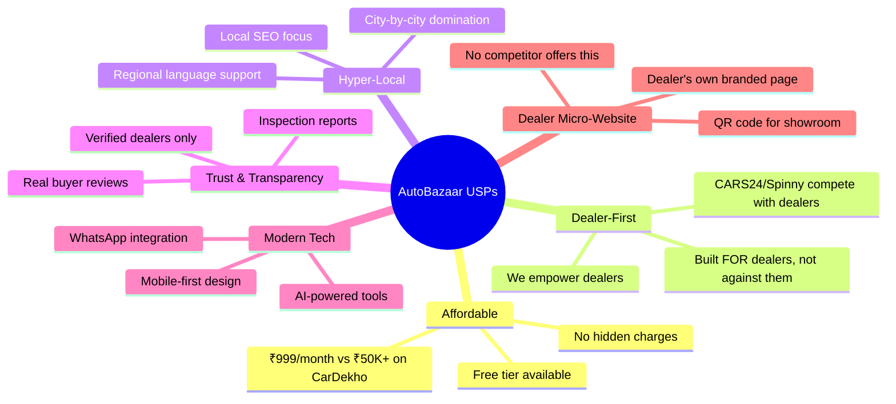

# 🚗 AutoBazaar — Business Analysis & Growth Strategy

> **Objective:** AutoBazaar ko ek simple car listing website se ek **revenue-generating dealer SaaS platform** banane ka complete roadmap.

---

## 📊 Part 1: Current State Audit

### Tumhare Paas Abhi Kya Hai (Phase 1-5 Complete)

| Feature | Status | Revenue Potential |
|:--------|:------:|:-----------------:|
| User Auth (Buyer + Dealer) | ✅ | — |
| Car Listing CRUD + Cloudinary Images | ✅ | Low |
| Public Browse + Search + Filters | ✅ | Low |
| Dealer Dashboard | ✅ | Low |
| Buyer Inquiry System | ✅ | Low |
| Deployment | 🔲 | — |

> [!WARNING]
> Abhi tumhare platform me **koi revenue model nahi hai**. Dealer ko free me sab mil raha hai — iska matlab koi reason nahi hai ki dealer tujhe paise de. Pehle **value create karo**, phir charge karo.

---

## 🏆 Part 2: Competitor Landscape

### Direct Competitors (India Market)

| Platform | Type | Target | Monthly Traffic | Revenue Model |
|:---------|:-----|:-------|:----------------|:--------------|
| **CarDekho** | Marketplace + SaaS | New + Used Cars | 50M+ | Lead-based fees, Ads, Commission |
| **CarWale** | Research + Marketplace | New Cars | 20M+ | Ads, Dealer partnership |
| **CARS24** | Full-stack marketplace | Used Cars | 15M+ | Commission on sale, Financing |
| **Spinny** | Full-stack marketplace | Used Cars | 10M+ | Commission, Insurance |
| **OLX Autos** | Classifieds | P2P + Dealer | 30M+ | Featured listings, Ads |
| **Droom** | Marketplace | New + Used | 8M+ | Subscription, Featured listings |
| **CarTrade** | B2B + B2C | Dealers | 5M+ | Subscription, Lead gen |

### Competitors Ki Weaknesses (Tumhara Opportunity)

| Competitor | Weakness | AutoBazaar Ka Advantage |
|:-----------|:---------|:------------------------|
| **CarDekho/CarWale** | Bohot expensive for small dealers (₹50K-2L/month) | Affordable plans starting ₹999/month |
| **OLX** | Fake listings, scammers, no trust | Verified dealer-only platform |
| **CARS24/Spinny** | They buy cars directly — dealers are competitors | Dealers ARE your customers |
| **Droom** | Complex UI, too many features | Simple, clean, mobile-first |
| **All of them** | Generic, national platforms — no local focus | Hyper-local, city-wise domination |

> [!IMPORTANT]
> **Tumhara real competitor OLX aur CarDekho nahi hai.** Tumhara competitor hai **wo Excel sheet ya WhatsApp group** jisme dealer abhi apne cars track karta hai. Tum unko usse better tool do — wohi tumhara pitch hai.

---

## 💰 Part 3: Revenue Models (Paisa Kaise Kamayenge)

### Model 1: Freemium Subscription Plans 🔥 (Primary Revenue)

```
┌─────────────────────────────────────────────────────────────────┐
│                    AUTOBAZAAR DEALER PLANS                       │
├──────────────┬──────────────┬──────────────┬────────────────────┤
│   FREE       │  STARTER     │  PRO         │  ENTERPRISE        │
│   ₹0/month   │  ₹999/month  │  ₹2,999/month│  ₹9,999/month     │
├──────────────┼──────────────┼──────────────┼────────────────────┤
│ 5 listings   │ 25 listings  │ Unlimited    │ Unlimited          │
│ Basic dash   │ Full dash    │ Full dash    │ Multi-branch dash  │
│ —            │ 5 boosts/mo  │ 20 boosts/mo │ Unlimited boosts   │
│ —            │ —            │ Analytics    │ Advanced analytics │
│ —            │ —            │ WhatsApp API │ WhatsApp + CRM     │
│ —            │ —            │ Priority     │ Dedicated manager  │
│ —            │ Dealer badge │ Verified PRO │ Premium partner    │
│ —            │ —            │ Lead alerts  │ AI lead scoring    │
└──────────────┴──────────────┴──────────────┴────────────────────┘
```

**Expected Revenue:** 
- 100 dealers × ₹999 = ₹99,900/month (Starter)
- 50 dealers × ₹2,999 = ₹1,49,950/month (Pro)
- **Total: ~₹2.5L/month just from subscriptions**

---

### Model 2: Featured/Boost Listings (Pay-per-use)

| Feature | Price | What It Does |
|:--------|:------|:-------------|
| **Spotlight Listing** | ₹99/day | Car appears at top of search results |
| **Homepage Feature** | ₹299/day | Car shown on homepage banner |
| **City Top 10** | ₹499/week | Guaranteed top 10 in city results |
| **Social Media Push** | ₹199/post | AutoBazaar posts car on Instagram/FB |

**Expected Revenue:** ₹50K-1L/month from active dealers

---

### Model 3: Lead Generation Fees

| Service | Price |
|:--------|:------|
| **Per verified lead** | ₹25-50/lead |
| **Bulk lead package (100 leads)** | ₹2,000 |
| **Premium leads (high-intent buyers)** | ₹100/lead |

---

### Model 4: Value-Added Services (Commission-based)

| Service | Commission | Partner |
|:--------|:-----------|:--------|
| **Car Loan Referral** | 0.5-1% of loan amount | Banks/NBFCs |
| **Insurance Referral** | ₹500-2000/policy | Insurance companies |
| **RTO Transfer Service** | ₹500 flat fee | Local agents |
| **Car Inspection** | ₹299-999/inspection | Third-party inspectors |

**Expected Revenue:** ₹1-3L/month at scale

---

## 🚀 Part 4: Features To Add (Differentiation Strategy)

### Phase 7: 💎 Dealer Subscription & Payment Gateway
> **Revenue Impact: HIGH** | **Difficulty: MEDIUM**

- [ ] Razorpay/Stripe payment integration
- [ ] Subscription plans (Free, Starter, Pro, Enterprise)
- [ ] Listing limits based on plan
- [ ] Auto-renewal & invoice generation
- [ ] Dealer billing dashboard

### Phase 8: 🔥 Featured/Boost Listings
> **Revenue Impact: HIGH** | **Difficulty: LOW**

- [ ] "Boost" button on each listing
- [ ] Spotlight badge on boosted cars
- [ ] Boosted cars appear first in search
- [ ] Time-limited boosts (1 day, 3 days, 7 days)
- [ ] Boost analytics (views before vs after)

### Phase 9: 📊 Advanced Dealer Analytics Dashboard
> **Revenue Impact: MEDIUM** | **Difficulty: MEDIUM**

- [ ] Total views per listing (daily/weekly/monthly)
- [ ] Inquiry conversion rate
- [ ] Most viewed cars
- [ ] Buyer demographics (city, search terms)
- [ ] Comparison with market average
- [ ] "Your car is priced 10% above market" alerts

### Phase 10: 🔍 Car Inspection & Trust System
> **Revenue Impact: HIGH** | **Difficulty: HIGH**

- [ ] 150-point inspection checklist (digital form)
- [ ] Inspection report attached to listing
- [ ] "AutoBazaar Certified" badge
- [ ] Star rating for dealers (buyer reviews)
- [ ] Dealer verification (GST, showroom photos)
- [ ] Trust score algorithm

### Phase 11: 💬 WhatsApp Integration & CRM
> **Revenue Impact: VERY HIGH** | **Difficulty: MEDIUM**

- [ ] One-click WhatsApp chat with dealer
- [ ] WhatsApp Business API for automated replies
- [ ] Inquiry → WhatsApp notification
- [ ] Follow-up reminders for dealers
- [ ] Chat history stored in dashboard
- [ ] Bulk WhatsApp broadcast for dealers (new arrivals)

### Phase 12: 📱 Dealer Micro-Website (Game Changer!)
> **Revenue Impact: VERY HIGH** | **Difficulty: MEDIUM**

- [ ] Each dealer gets: `autobazaar.com/dealer/abc-motors`
- [ ] Their own branded page with logo, banner, about
- [ ] All their listings in one place
- [ ] Contact info, Google Maps location
- [ ] Share link on social media
- [ ] QR code for showroom display
- [ ] **This alone is worth ₹999/month to dealers!**

### Phase 13: 🤖 AI-Powered Features (Premium Tier)
> **Revenue Impact: HIGH** | **Difficulty: HIGH**

- [ ] AI price suggestion (based on market data)
- [ ] Auto-generate car description from photos
- [ ] Smart listing title generator
- [ ] Buyer intent scoring (which buyers are serious)
- [ ] "Similar cars" recommendation engine
- [ ] Chatbot for buyer queries (24/7)

### Phase 14: 📲 Mobile App (PWA)
> **Revenue Impact: MEDIUM** | **Difficulty: MEDIUM**

- [ ] Progressive Web App (works like native app)
- [ ] Push notifications for new inquiries
- [ ] Offline-capable listing management
- [ ] Camera integration for quick listing upload
- [ ] Install prompt on mobile browsers

---

## 🎯 Part 5: Unique Selling Points (USPs) — What Makes AutoBazaar Different



---

## 📋 Part 6: Dealer Pitch Strategy

### Pitch Deck Key Slides

#### Slide 1: Problem
> "Aap abhi cars WhatsApp pe list karte ho, OLX pe fake inquiries milti hain, aur CarDekho ka monthly charge ₹50K+ hai. Kya aapko ek affordable, trusted platform chahiye?"

#### Slide 2: Solution
> "AutoBazaar ek dealer-first marketplace hai jahan aap ₹999/month me unlimited tools paate ho — dashboard, analytics, WhatsApp integration, aur apni khud ki branded website."

#### Slide 3: Why Not OLX?
| Problem with OLX | AutoBazaar Solution |
|:-----------------|:-------------------|
| Fake buyers | Verified buyers only |
| No dashboard | Full analytics dashboard |
| No brand presence | Your own micro-website |
| No lead tracking | CRM + WhatsApp alerts |
| Looks cheap | Premium, professional look |

#### Slide 4: Pricing
> "Shuru karo FREE me. Jab results dikhe, upgrade karo."

#### Slide 5: ROI Calculator
> "Agar AutoBazaar se mahine me sirf **2 extra cars** bikti hain, toh ₹999 ka plan tumhe **₹40,000-1,00,000 profit** deta hai. That's **40-100x ROI**."

---

## 📈 Part 7: Implementation Priority (Revenue-First Approach)

> [!TIP]
> Pehle woh features banao jo **directly paisa laayein**. Analytics aur AI baad me aa sakta hai.

### Priority Matrix

| Priority | Phase | Feature | Revenue Impact | Time to Build |
|:---------|:------|:--------|:---------------|:--------------|
| 🔴 P0 | 6 | **Deploy (Vercel + Render)** | Prerequisite | 1-2 days |
| 🔴 P0 | 7 | **Payment + Subscription Plans** | ₹2.5L/month | 1 week |
| 🟠 P1 | 12 | **Dealer Micro-Website** | Game changer for pitch | 3-4 days |
| 🟠 P1 | 8 | **Featured/Boost Listings** | ₹1L/month | 3-4 days |
| 🟡 P2 | 11 | **WhatsApp Integration** | Very high retention | 3-4 days |
| 🟡 P2 | 10 | **Trust System (Reviews + Verification)** | Trust = more users | 1 week |
| 🟢 P3 | 9 | **Advanced Analytics** | Upsell to Pro plan | 1 week |
| 🟢 P3 | 13 | **AI Features** | Premium tier USP | 2 weeks |
| 🔵 P4 | 14 | **Mobile PWA** | Better UX | 1 week |

---

## 🏁 Part 8: First 90 Days Action Plan

### Month 1: Foundation (Build & Deploy)
- ✅ Complete Phase 6 (Deploy)
- ✅ Build Payment Gateway (Razorpay)
- ✅ Create Subscription Plans
- ✅ Build Dealer Micro-Website feature
- 🎯 **Target: 10 local dealers signed up (free tier)**

### Month 2: Growth (Features & Sales)
- ✅ Add Featured/Boost Listings
- ✅ WhatsApp Integration
- ✅ Dealer Verification System
- ✅ Start visiting local dealers in your city
- 🎯 **Target: 50 dealers, 5 paying (₹5,000 revenue)**

### Month 3: Scale (Marketing & Premium)
- ✅ Advanced Analytics Dashboard
- ✅ Social Media Marketing
- ✅ Google Ads for local SEO
- ✅ Dealer referral program (₹200 credit per referral)
- 🎯 **Target: 200 dealers, 30 paying (₹45,000 revenue)**

---

## 💡 Part 9: Secret Weapons (Features No Competitor Has)

### 1. 📸 "List in 60 Seconds" (Mobile Camera Flow)
Dealer opens phone → Takes 5 photos → AI auto-fills details → Listing live in 60 seconds.
*No competitor makes listing this fast.*

### 2. 🏪 Dealer QR Code
Print a QR code, paste it on showroom window. Buyer scans → sees all inventory.
*Physical-to-digital bridge that OLX/CarDekho don't offer.*

### 3. 📊 "Market Pulse" Weekly Report
Every Monday, dealers get an email: "This week in your city — Top searched cars, average prices, demand trends."
*Free for all dealers. Builds trust and habit.*

### 4. 🤝 "Dealer Network" (Dealers help each other)
Dealer A has a buyer for Honda City, but doesn't have stock. Dealer B has stock.
AutoBazaar connects them → Takes ₹500 matchmaking fee.
*No competitor does B2B dealer matching.*

### 5. 💳 EMI Calculator on Every Listing
Buyer sees "₹5,999/month EMI" instead of "₹5,00,000 price".
*Psychologically makes cars feel affordable. Increases inquiries by 30-40%.*

---

> [!NOTE]
> **Summary:** AutoBazaar ka core value proposition hai — "**We are the affordable, dealer-first alternative to CarDekho**". Tumhare competitors bohot bade hain, lekin unki weakness hai cost aur complexity. Tum simplicity, affordability, aur local trust pe jeeto. Pehle ek city dominate karo, phir expand karo.

