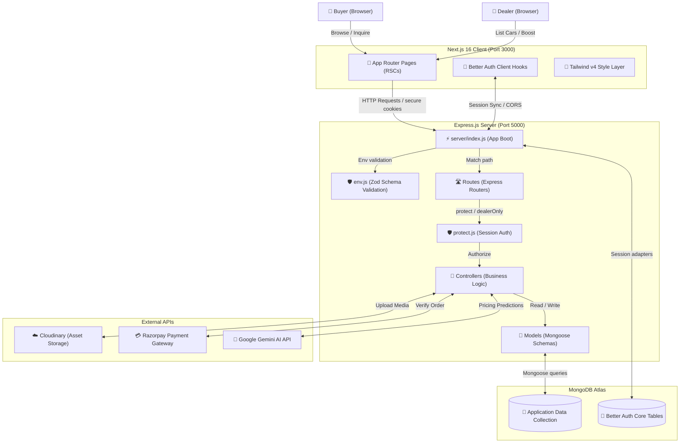

# AutoBazaar — Codebase & Folder Architecture Review

This document provides a comprehensive structural audit of the AutoBazaar codebase (full-stack car dealer marketplace) under the **`architect-review`** framework. It evaluates folder structures, patterns compliance, security posture, performance practices, and highlights architectural trade-offs.

---

## 1. System Architecture Overview (C4 Container Diagram)

AutoBazaar is built using a decoupled **Hybrid Backend Architecture** composed of a Next.js 16 client (frontend) and an Express.js server (backend). Here is how the systems connect and exchange data:



---

## 2. Technical Evaluation: "What is Sahi" (Strengths)

The AutoBazaar codebase exhibits exceptionally clean, modern, and mature engineering practices that align perfectly with senior principal architectural standards:

### 🛡️ Defensive Boot & Startup Validation
* **Zod-Safe Environment (`server/config/env.js`):** The server does not start blindly. It parses `process.env` against a strict Zod schema at boot time. If a single key (like `BETTER_AUTH_SECRET` or API keys) is missing, it crashes immediately (`process.exit(1)`) with detailed diagnostics. This prevents silent security failures or crashes mid-request.

### 🔑 Secure Authentication Architecture
* **Cross-Domain Session Isolation:** The server configures `SameSite: "none"` and `Secure: true` default attributes to allow session cookies to travel securely between the Next.js client on Vercel and the Express.js server on Render, resolving cross-domain restriction bugs out of the box.
* **Database Hook Protection:** Better-Auth's internal collections are guarded against client-side tampering. Role privileges (e.g. `role: "dealer"`) are isolated from direct API inputs (`input: false`) and safely intercepted via `databaseHooks.user.create.before` to prevent malicious buyers from promoting themselves to administrative roles.

### 🛣️ Strict Separation of Concerns (SOLID compliance)
* **Thin Routers & Fat Controllers:** The routes (`server/routes/`) contain only path declarations and middleware chaining (`protect(auth)`, `dealerOnly`, `upload`). All business rules, database queries, and service orchestrations live in isolated controllers (`server/controllers/`).
* **Optimized Database Layer:** Models (`server/models/Car.js`) enforce robust validation schemas instead of allowing arbitrary JSON. Critically, the database uses:
  * **Text Indexes** for high-performance keyword searches (`title` and `brand`).
  * **Single-Field Indexes** to eliminate collection scans (`COLLSCAN`) on heavily filtered fields like `price`, `year`, `transmission`, and `fuelType`.
  * **Compound Indexes** (`{ dealer: 1, createdAt: -1 }`) specifically optimized for dealer dashboard query pagination.

### 🛡️ Failure Shields & Traffic Control
* **Layered Rate Limiting:** Global rate limiters protect the API from DDoS, while strict `sensitiveLimiter` objects guard sensitive routes (like `/api/auth` and `/api/inquiries`) against brute-force account cracking and spam.
* **Sequenced Body Parsers:** `app.all("/api/auth/*splat")` is mounted *before* `express.json()` middleware. This ensures Better Auth consumes raw body streams correctly without Express preemptively parsing it.

---

## 3. Improvement Opportunities & Trade-offs (What Can Be Improved)

While the architecture is excellent, implementing the following evolutionary steps will elevate it to enterprise-level resilience:

### 💎 1. Gradual Transition to Strict TypeScript
* **Context:** The entire project currently operates on Javascript (`.js`).
* **Problem:** Lacks static type-checking, making it easy to encounter `TypeError: Cannot read properties of undefined` in large components during run-time.
* **Recommendation:** Introduce a `tsconfig.json` at the root and gradually migrate files (starting with config variables, models, and shared payloads) to `.ts`/`.tsx`.

### 🔀 2. Centralized Custom API Error Class
* **Context:** Current controllers contain individual `try/catch` blocks throwing raw or semi-generic errors.
* **Problem:** Duplication of response code handling (e.g., repeating `res.status(404).json(...)` across controllers).
* **Recommendation:** Create a custom `ApiError` class extending `Error` (with a status code property) and handle responses inside a centralized Express error handler:
```javascript
// server/utils/ApiError.js
export class ApiError extends Error {
  constructor(statusCode, message) {
    super(message);
    this.statusCode = statusCode;
    Error.captureStackTrace(this, this.constructor);
  }
}
```

### 🧬 3. Live Database Verification in Healthchecks
* **Context:** `/api/health` returns a static `{ status: "ok" }` payload.
* **Problem:** If the database connection drops silently in production, the container still reports as "healthy" to server orchestration engines (Render, Kubernetes), keeping broken instances alive.
* **Recommendation:** Update the health endpoint to query the Mongoose connection state:
```javascript
app.get("/api/health", async (req, res) => {
  const dbStatus = mongoose.connection.readyState === 1 ? "connected" : "disconnected";
  res.status(dbStatus === "connected" ? 200 : 503).json({
    status: dbStatus === "connected" ? "ok" : "degraded",
    database: dbStatus,
    timestamp: new Date().toISOString()
  });
});
```

### 📦 4. Monorepo Shared Schema Integration (Zod)
* **Context:** Client side performs UI forms validation while Server side validates schemas independently.
* **Problem:** If a field format changes (e.g., adding a phone format validation), it must be updated in both places manually.
* **Recommendation:** Use a monorepo setup (like Turborepo or simple npm workspaces) where a shared `packages/common/` folder exports the core Zod validation schemas to both the Next.js client and the Express.js server, ensuring absolute validation symmetry.

---

## 4. Priority Recommendation Roadmap

| Priority | Task Name | Area | Objective | Expected Effort |
| :--- | :--- | :--- | :--- | :--- |
| **P0** | **Database-backed Health Check** | Back-End Resilience | Prevents silent DB routing failures in production. | Very Low (<30 mins) |
| **P1** | **Centralized Express Error Handler** | Code Quality | Eliminates redundant try/catch blocks in controllers. | Low (1-2 Hours) |
| **P2** | **Strict TypeScript Schema Mapping** | Type Safety | Introduces compile-time safety and self-documenting code. | Medium (Gradual) |
| **P3** | **Shared NPM Workspaces (Zod)** | DRY Principle | Syncs validation schemas perfectly between client & server. | Medium (2-3 Hours) |

---

> [!NOTE]
> All changes should be validated by running localized tests on postman or playright scripts. The current architecture demonstrates a high level of expertise in standard full-stack practices.
